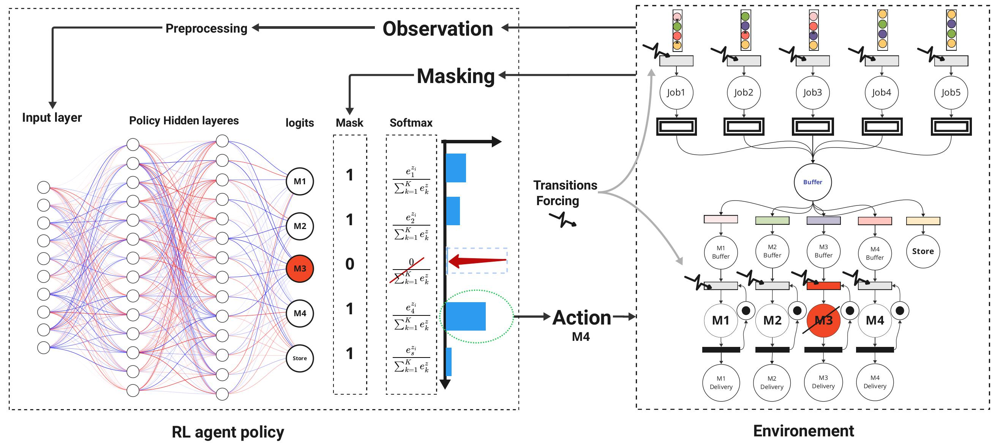

# PetriRL DJSSP

Reinforcement learning for the Dynamic Job Shop Scheduling Problem under uncertainty: random job arrivals and
machine breakdowns. The shop is modeled as a colored timed Petri net and solved with Maskable PPO.
Part of the [PetriRL framework](https://github.com/Sofiene-Uni/PetriRL-Framework).



- **Stochastic events**: job arrivals follow a Gamma distribution, machine failures a Weibull distribution.
- **Dynamic action masking**: Petri net guard functions block actions on missing jobs or broken machines.
  Two masking methods are compared: overriding invalid action probabilities, and negative gradients on invalid actions.
- **No retraining**: the trained policy keeps scheduling when disruptions occur.
- **Result**: lower makespan than classical dispatching rules on dynamic JSSP benchmarks.

## Getting Started

```bash
pip install petrirl sb3-contrib torch
python train.py   # or: python test.py (evaluates the agents in agents/)
```

```python
import gymnasium as gym
import petrirl

env = gym.make("petrirl-dft-v0", benchmark="Solax", instance_id="sl00", reward_f="G",
               random_arrival=True, machine_down=True)
```

Solax `sl00`-`sl79` correspond to Taillard `ta01`-`ta80`. `time_seeds/` holds the random seeds used for evaluation.
For an interactive interface, see [PetriRL Studio](https://github.com/Sofiene-Uni/PetriRL-Studio).

## Citation

Developed by Sofiene Lassoued during his PhD at South Westphalia University of Applied Sciences (FH SWF).
If you use this work, please cite:

```bibtex
@article{lassoued2026djssp,
  title   = {Policy-Based Reinforcement Learning with Action Masking for Dynamic Job Shop Scheduling under Uncertainty: Handling Random Arrivals and Machine Failures},
  author  = {Lassoued, Sofiene and Lier, Stefan and Schwung, Andreas},
  journal = {arXiv preprint arXiv:2601.09293},
  year    = {2026}
}

@article{lassoued2024petrirl,
  title   = {Introducing PetriRL: An innovative framework for JSSP resolution integrating Petri nets and event-based reinforcement learning},
  author  = {Lassoued, Sofiene and Schwung, Andreas},
  journal = {Journal of Manufacturing Systems},
  volume  = {74},
  pages   = {690--702},
  year    = {2024},
  doi     = {10.1016/j.jmsy.2024.04.028}
}
```
